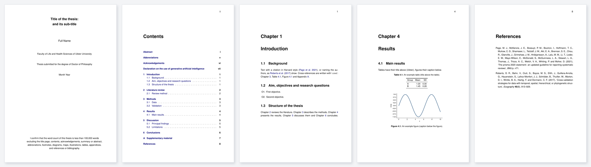
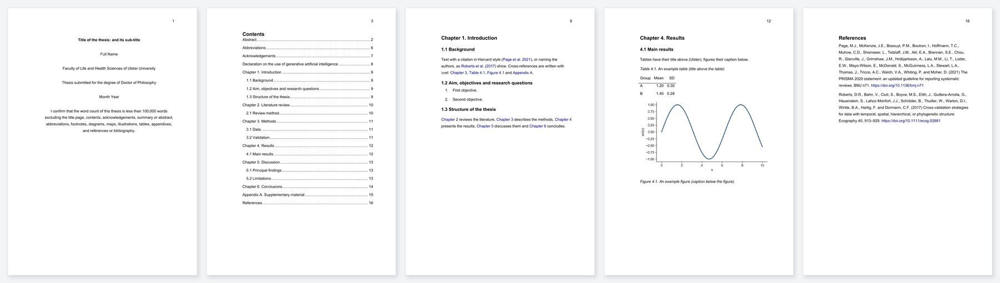

# Ulster University thesis template (LaTeX, PDF and Word)

An **unofficial** LaTeX template for Ulster University research degree theses (PhD, MPhil, professional doctorates), set up
to the Doctoral College's *Format of Thesis* guidance, with:

- a PDF that follows the required layout;
- a Word version built from the same source, for supervisors who review in Word;
- ready-made downloads, with every section in place and guidance text to replace:
  - **[Overleaf / LaTeX ZIP](https://github.com/GeospatialGeeks/ulster-thesis-template/raw/main/downloads/Ulster-thesis-template-Overleaf.zip)**:
    upload it to Overleaf as a new project, or unzip it for any LaTeX editor;
  - [Word](https://github.com/GeospatialGeeks/ulster-thesis-template/raw/main/downloads/Ulster-thesis-template.docx)
    and [PDF](downloads/Ulster-thesis-template.pdf), if you prefer to start in Word or want to see the result first.

It is not endorsed by Ulster University. Always check the current guidance and your faculty's requirements before
submission (links below).

## What you get

The same source gives both versions. Title page, contents, a chapter opening, a results page with a table and a
figure, and the references:

**PDF** (`main.pdf`)



**Word** (`Thesis.docx`)



Both versions have the same:
- title page, with the word-count statement at the foot and no page number;
- page numbering: roman for the preliminary pages, arabic from Chapter 1, top right;
- numbering of chapters, sections, tables, figures and equations, with cross-references and citations as links;
- table layout (rules above and below the table and under the header row, no vertical lines), captions (bold label,
  titles above tables, captions below figures), headings and line spacing.

The Word version uses real Word styles: headings appear in the navigation pane, each chapter starts on a new page,
and the contents and lists of figures and tables are Word fields. The two reference lists differ slightly (see
[Reference list](#reference-list)).

Why not identical? LaTeX and Word lay out text differently (line breaking, hyphenation, float placement), so pages break
in slightly different places, and the fonts differ (Helvetica in the PDF, Arial in Word, as the guidance allows). The
converter maps the structure and the styles, not every pixel. The PDF is the version to submit.

## What is set up for you

| Requirement (Doctoral College guidance) | How the template implements it |
|---|---|
| A4 portrait | `geometry` with `a4paper` |
| Sans-serif font (Helvetica or Arial), 12 pt | Helvetica (`helvet`) at 12 pt; Arial in the Word version |
| Line spacing 1.5; extra space after each paragraph | `setspace` (`\onehalfspacing`), `parskip` |
| Binding margin at least 40 mm, other margins at least 20 mm | Left 40 mm; right, top and bottom 25 mm |
| Page numbers, preferably top outer corner; roman numerals for introductory pages | `fancyhdr`, top right; roman, then arabic from Chapter 1 |
| Title page: title (and sub-title), author's full name, faculty "of Ulster University", degree, month and year, word-count statement | `thesis-info.tex` and the title page in `main.tex` |
| Abstract of at most 300 words | `chapters/00_abstract.tex` (with a reminder) |
| Contents, with lists of figures and tables; key of abbreviations | `\tableofcontents`, `\listoffigures`, `\listoftables`; abbreviations with `glossaries` |
| Acknowledgements (including assistance received, and your contribution to collaborative work) | `chapters/00_acknowledgements.tex` |
| Order: preliminary pages, main text, appendices, references | As in `main.tex` |
| Figure numbers and captions below figures; tables numbered separately, with titles above | `caption`; examples in `chapters/04_results.tex` |
| UK English | `babel` British |
| Harvard referencing | `natbib` author-year, `(Author Year)` without a comma; a Harvard (LHS) CSL style for the Word version |
| Declaration on the use of generative AI, where required | `chapters/00_declaration_ai.tex` (template text; follow the Doctoral College guidance on generative AI) |

Hyperlinks for cross-references, citations and URLs are on, in dark colours that print well.

## Use it

**Overleaf**
1. Download [Ulster-thesis-template-Overleaf.zip](https://github.com/GeospatialGeeks/ulster-thesis-template/raw/main/downloads/Ulster-thesis-template-Overleaf.zip)
   (the LaTeX source only, nothing else to remove).
2. In Overleaf, choose *New Project*, then *Upload Project*, and select the ZIP.
3. Set the compiler to pdfLaTeX (*Menu*, then *Settings*). The included `latexmkrc` builds the list of abbreviations.
4. Fill in `thesis-info.tex` and start writing in `chapters/`.

**Your computer** (TeX Live or MiKTeX, with Python 3 for the build script)
```bash
git clone https://github.com/GeospatialGeeks/ulster-thesis-template my-thesis
cd my-thesis
python build.py              # main.pdf
python build.py --docx       # also Thesis.docx (needs pandoc and research-helpers, see below)
```
You can also use `latexmk -pdf main.tex`.

**Word version.** Install [pandoc](https://pandoc.org/installing.html) and the converter:
```bash
pip install git+https://github.com/GeospatialGeeks/research-helpers
```
`python build.py --docx` then writes `Thesis.docx`, keeping:
- the numbers of chapters, sections, tables and figures, and the cross-references as links;
- citations in the Harvard style of `ulster-harvard-lhs.csl`;
- the Ulster page set-up.

A figure that exists only as PDF is converted to PNG for Word automatically (with `pdftoppm`, which comes with TeX
Live and MiKTeX). When Word opens the file, it asks whether to update the fields: choose *Yes* to fill in the contents
and the lists of figures and tables. `python build.py --docx --downloads` also refreshes the files in `downloads/`.

**Start in Word.** Download [the blank Word file](downloads/Ulster-thesis-template.docx) and replace the guidance
text. Its styles carry the formatting:
- *Heading 1* for chapters (starts a new page), *Heading 2* and *Heading 3* for sections;
- *Body Text* for paragraphs;
- *Table Caption* above tables and *Image Caption* below figures. The lists of figures and tables are built from these
  two styles: right-click a list and choose *Update Field*;
- the contents updates the same way.

Chapter, figure and table numbers in this file are typed text: renumber them by hand when you add one, or write in
LaTeX, where the numbering is automatic.

## Write

1. Fill in `thesis-info.tex`: title, name, faculty, degree, and the month and year of submission.
2. Write the chapters in `chapters/`. Add or rename chapters in `main.tex`.
3. Put figures in `figures/`. Use PDF for the PDF build, plus a PNG of the same name for Word.
   `figures/make_example.py` shows how to save a matplotlib figure in both formats. Give figures distinctive names:
   a bare name such as `example` can match a file of the same name inside your TeX installation.
4. Add references to `references.bib`: export from Zotero with Better BibTeX (see
   [Citations with Zotero](#citations-with-zotero)), or get BibTeX for a DOI with `rh bib refs.bib key=DOI`
   (research-helpers), which also checks the DOI against Crossref.
5. Cite with `\citep{key}` for "(Author Year)" and `\citet{key}` for "Author (Year)". Cross-reference with
   `\cref{label}`, which writes "Chapter 3", "Table 4.1" and so on.

## Reference list

- **PDF:** uses the `agsm` Harvard style from the `natbib` family. Its reference list is close to, but not identical
  with, the Ulster Library Harvard guides: `agsm` joins the last two authors with "&". Check the Library guide for your
  faculty, and adjust if your examiners require it.
- **Word:** uses `ulster-harvard-lhs.csl`: "Author, A. and Author, B. (Year) Title. Journal, volume, pages. DOI".

## Citations with Zotero

**In LaTeX (PDF), including Overleaf**
1. Install the [Better BibTeX](https://retorque.re/zotero-better-bibtex/installation/) plugin for Zotero (*Tools*,
   *Plugins*, then the gear icon, *Install Plugin From File*).
2. Right-click your thesis collection, *Export Collection*, choose *Better BibTeX* and tick *Keep updated*, and save it
   as `references.bib` in this folder. Zotero now rewrites the file whenever you add or edit a reference.
3. Cite with the Better BibTeX keys: `\citep{key}`. In VS Code, the *Zotero Citation Picker* extension inserts them
   from Zotero's search box. The reference list is rebuilt at every compile.
4. On Overleaf, upload `references.bib` after changes, or link it to Zotero (*New file*, *From Zotero*, on Overleaf
   plans that include it).

**In Word, with the Zotero Word plug-in**
1. Add the Ulster style to Zotero: double-click `ulster-harvard-lhs.csl`, or *Settings*, *Cite*, then the `+` button.
2. In Word, *Zotero*, *Document Preferences*: choose *Ulster University Harvard (LHS), unofficial*.
3. Insert citations with *Add/Edit Citation*, and the reference list with *Add/Edit Bibliography* under the
   *References* heading. Zotero writes the list in the *Bibliography* style, which the template formats (hanging
   indent, spacing), and keeps citations and list up to date as you write.

In the converted Word file and the blank Word file, the example citations and their reference list are plain text.
Delete them before inserting citations with Zotero: a Word document should take its citations from one source only.

## Sources

- Ulster University Doctoral College, [Format of Thesis](https://www.ulster.ac.uk/doctoralcollege/current/submitting-your-thesis/thesis-format)
  and [Notes of guidance](https://www.ulster.ac.uk/doctoralcollege/current/submitting-your-thesis/notesofguidance).
- Ulster University Doctoral College, *Guidance for printing of theses for research degrees*.
- Ulster University Doctoral College, [Guidance on the use of generative AI tools](https://www.ulster.ac.uk/doctoralcollege/current/research-studies-guide/guidance-on-the-use-of-generative-ai-tools).
- Ulster University Library, Harvard referencing guides.

## Ownership and funding

Copyright © Ulster University: developed by Ammar Ahmad during a PhD at Ulster University, funded by a Vice-Chancellor's Research Scholarship (VCRS); intellectual property arising from research degrees belongs to the University under its Intellectual Property Policy. Released under the MIT licence.

## Licence and contributions

MIT licence (see `LICENSE`): use, adapt and share freely. Corrections and improvements are welcome as issues or pull
requests, especially where the guidance changes.

Maintained by Ammar Ahmad (School of Geography and Environmental Sciences, Ulster University).
